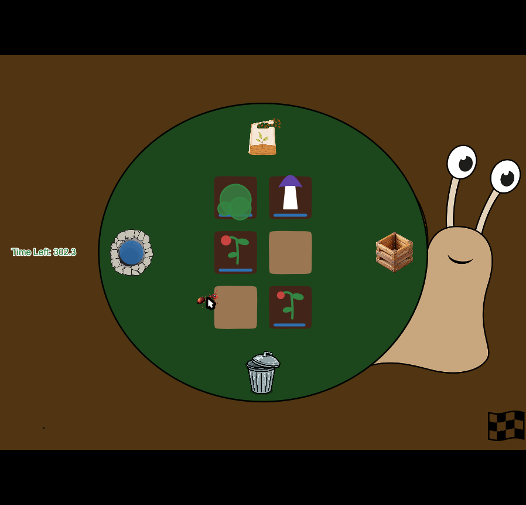

# Desmos Snail Game
This is a game that I made for the Hack Club [wrong](https://wrong.hackclub.com) contest in Desmos Graphing Calculator.

## Getting to the game
Two options:
- Desmos link (easiest): open [https://www.desmos.com/calculator/s6kdc5jkgv](https://www.desmos.com/calculator/s6kdc5jkgv)
- JSON Import: copy the entire contents of [state.json](./state.json) and paste them into a [blank Desmos page](https://desmos.com/calculator) or run
```javascript
fetch('https://raw.githubusercontent.com/dylanmccune/snail-game/refs/heads/main/state.json')
  .then(r => r.json())
  .then(data => Calc.setState(data))
```
in the console.

After that, click the ticker play button in the top left and start playing the game!

## How to play
You are an ant, living on the back of a giant snail trying to cross a garden. In order to get across the garden, you need to grow food for the snail to eat. There are three types of food:
| Food      | Growth Time | Speed multiplier | Duration |
|-----------|-------------|------------------|----------|
| Moss      | 12s         | 1x               | 15s      |
| Berries   | 24s         | 1.5x             | 20s      |
| Mushrooms | 30s         | 2.5x             | 15s      |
Grow different crops by taking seeds from the seed depot at the top, then plant and water them. Once the crops are done growing, you can pick them and drop them off to the snail in the crate on the right. 
Move around by clicking where you want to go.

## Why Desmos?
I really like Desmos because it seems like just a calculator, but really you can do lots of cool things with it, including building games like this one. I find it fun (although this is a minority) because you have constraints and you need to be creative to work around them. Sometimes the limitations of building a game in a calculator do become annoying.
